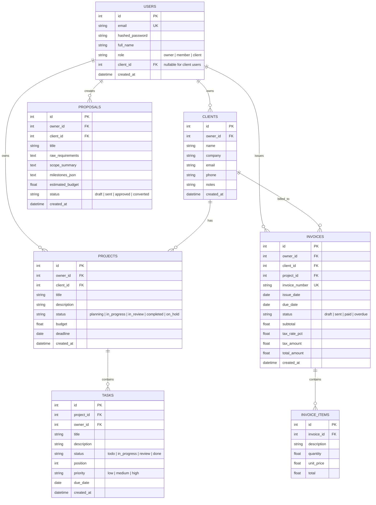

# System Architecture & Technical Specifications — ProjectPilot

**Author:** Software Architect  
**Version:** 1.0.0 (Day 1 Specification)  
**Status:** Approved & Frozen  

---

## 1. System Topology & Directory Structure

ProjectPilot uses a modular full-stack architecture decoupling the FastAPI backend REST service from the React/TypeScript frontend Single Page Application (SPA).

```
projectpilot/
├── .env.example
├── .gitignore
├── PRD.md
├── ARCHITECTURE.md
├── DESIGN.md
├── TASKS.md
├── TEST_REPORT.md
├── SECURITY_REPORT.md
├── DEPLOYMENT.md
├── README.md
├── docker-compose.yml
├── docs/
│   └── DAY_1_NOTES.md
├── backend/
│   ├── alembic.ini
│   ├── requirements.txt
│   ├── Dockerfile
│   ├── alembic/
│   │   ├── env.py
│   │   └── versions/
│   ├── app/
│   │   ├── __init__.py
│   │   ├── main.py
│   │   ├── core/
│   │   │   ├── __init__.py
│   │   │   ├── config.py
│   │   │   ├── database.py
│   │   │   └── security.py
│   │   ├── models/
│   │   │   ├── __init__.py
│   │   │   └── models.py
│   │   ├── schemas/
│   │   │   ├── __init__.py
│   │   │   ├── auth.py
│   │   │   ├── client.py
│   │   │   ├── project.py
│   │   │   ├── task.py
│   │   │   ├── invoice.py
│   │   │   └── proposal.py
│   │   ├── services/
│   │   │   ├── __init__.py
│   │   │   ├── auth_service.py
│   │   │   ├── kanban_service.py
│   │   │   ├── invoice_service.py
│   │   │   └── proposal_service.py
│   │   └── api/
│   │       ├── __init__.py
│   │       └── v1/
│   │           ├── __init__.py
│   │           ├── router.py
│   │           └── endpoints/
│   │               ├── __init__.py
│   │               ├── auth.py
│   │               ├── clients.py
│   │               ├── projects.py
│   │               ├── tasks.py
│   │               ├── invoices.py
│   │               ├── proposals.py
│   │               └── dashboard.py
│   └── tests/
│       ├── __init__.py
│       ├── conftest.py
│       ├── test_auth.py
│       └── test_models.py
└── frontend/
    ├── package.json
    ├── vite.config.ts
    ├── tsconfig.json
    ├── tailwind.config.js
    ├── src/
    │   ├── main.tsx
    │   ├── App.tsx
    │   ├── api/
    │   ├── components/
    │   │   ├── common/
    │   │   ├── layout/
    │   │   └── kanban/
    │   ├── context/
    │   ├── pages/
    │   └── types/
    └── tests/
```

---

## 2. Relational Database Schema & Entities

The entity model is constructed around multi-tenant ownership, ensuring that all resources belong to an `owner_id`.



---

## 3. OpenAPI REST Contract Matrix

All protected endpoints enforce `Authorization: Bearer <access_token>` headers.

| Domain | Method | Endpoint | Allowed Roles | Description |
| :--- | :--- | :--- | :--- | :--- |
| **Auth** | `POST` | `/api/v1/auth/signup` | Public | Registers a new user (`owner`, `member`, `client`) |
| **Auth** | `POST` | `/api/v1/auth/login` | Public | Returns `access_token` and `refresh_token` |
| **Auth** | `POST` | `/api/v1/auth/refresh` | Public | Issues a new access token via valid refresh token |
| **Auth** | `GET` | `/api/v1/auth/me` | Authenticated | Returns current authenticated user profile |
| **Clients** | `GET` | `/api/v1/clients` | `owner`, `member` | Lists all clients owned by current user |
| **Clients** | `POST` | `/api/v1/clients` | `owner` | Creates a new client profile |
| **Clients** | `GET` | `/api/v1/clients/{id}` | `owner`, `member` | Retrieves client profile with aggregated project metrics |
| **Clients** | `PUT` | `/api/v1/clients/{id}` | `owner` | Updates client profile |
| **Clients** | `DELETE`| `/api/v1/clients/{id}` | `owner` | Deletes client record (with cascade protection) |
| **Projects**| `GET` | `/api/v1/projects` | All roles | Lists accessible projects (Clients restricted to their ID) |
| **Projects**| `POST` | `/api/v1/projects` | `owner` | Creates a new project tied to a client |
| **Projects**| `GET` | `/api/v1/projects/{id}`| All roles | Project details with task counts and milestone progress |
| **Projects**| `PUT` | `/api/v1/projects/{id}`| `owner`, `member` | Updates project details and delivery status |
| **Projects**| `DELETE`| `/api/v1/projects/{id}`| `owner` | Removes project record |
| **Tasks** | `GET` | `/api/v1/projects/{id}/tasks` | All roles | Lists tasks ordered by `status` and `position` |
| **Tasks** | `POST` | `/api/v1/projects/{id}/tasks` | `owner`, `member` | Appends a task to a specified column |
| **Tasks** | `PATCH`| `/api/v1/tasks/{id}/position` | `owner`, `member` | Updates task column status and order position |
| **Tasks** | `DELETE`| `/api/v1/tasks/{id}` | `owner`, `member` | Deletes a task |
| **Invoices**| `GET` | `/api/v1/invoices` | All roles | Invoices list (filtered by owner or client) |
| **Invoices**| `POST` | `/api/v1/invoices` | `owner` | Generates a new invoice with itemized lines |
| **Invoices**| `GET` | `/api/v1/invoices/{id}/pdf` | All roles | Streams server-rendered vector PDF file |
| **Proposals**| `POST`| `/api/v1/proposals/generate` | `owner` | AI service: transforms text requirements into proposal |
| **Proposals**| `POST`| `/api/v1/proposals/{id}/convert`| `owner` | Converts approved proposal into Project + Tasks |
| **Dashboard**| `GET` | `/api/v1/dashboard/metrics` | `owner` | Computes revenue, active projects, and overdue tasks |

---

## 4. Security & Tenant Isolation Model

1. **Authentication:**
   - Password hashing: `bcrypt` with work factor 12.
   - Access tokens: Signed with `HMAC-SHA256` (`HS256`), 15-minute expiration.
   - Refresh tokens: Stored with 7-day expiration, invalidated on password reset.
2. **Tenant Isolation:**
   - Every read and write query in SQLAlchemy must explicitly include `owner_id == current_user.id`.
   - For `role == "client"`, queries must enforce `client_id == current_user.client_id`.
   - Direct object reference (IDOR) attacks return HTTP 404 (Not Found) rather than revealing resource existence.
3. **CORS & Input Validation:**
   - Strict origin whitelisting via FastAPI `CORSMiddleware`.
   - Pydantic v2 schemas reject malformed email strings, negative financial figures, and unescaped input.
