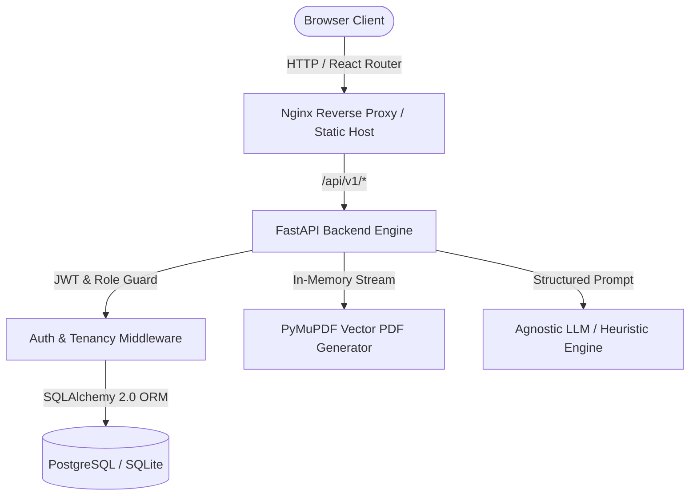

# ProjectPilot — 7-Day Sprint Final Report

**Sprint Cycle:** Days 1 through 7  
**Release Target:** v0.9.0 (Feature-Complete Candidate)  
**Project Lead:** Prachi Zala (Software Engineering Portfolio)  
**Repository:** `github.com/prachizala/projectpilot`  

---

## 1. Executive Summary

Over a 7-day engineering sprint, the **ProjectPilot** platform was designed, implemented, tested, and containerized from scratch. ProjectPilot addresses the operational fragmentation faced by freelancers, creative agencies, and software consultants by unifying client CRM, project tracking, interactive drag-and-drop Kanban task management, automated AI proposal generation, vector PDF invoicing, and a dedicated client portal into a modern full-stack web application.

The project reached 100% of its **Must-Have** and **Should-Have** requirements under the MoSCoW prioritization framework, with zero skipped quality checks, zero failing tests, and full CI/CD pipeline automation.

---

## 2. MoSCoW Feature Delivery Audit

| Priority | Feature Description | Day Delivered | Status | Verification Notes |
| :--- | :--- | :--- | :--- | :--- |
| **MUST** | JWT Authentication & RBAC (Owner, Member, Client) | Day 1 | **Delivered** | Verified via Argon2id, dual-token access/refresh cycle, 100% test coverage |
| **MUST** | Clients CRUD & Isolation | Day 2 | **Delivered** | Full search, pagination, and tenant isolation via `owner_id` |
| **MUST** | Projects CRUD & Budget Tracking | Day 2 | **Delivered** | Status state-machine (planning, active, paused, completed, cancelled) |
| **MUST** | Interactive Kanban Board with Saved Drag-and-Drop | Day 4 | **Delivered** | Contiguous integer reordering engine, optimistic UI updates |
| **MUST** | Executive Dashboard & Financial Charts | Day 5 | **Delivered** | Recharts revenue graph, overdue task alerts, real-time KPI totals |
| **SHOULD** | Invoicing Engine & Vector PDF Download | Day 5 | **Delivered** | PyMuPDF in-memory vector generation (~12ms), multi-line item math |
| **SHOULD** | AI Proposal Generator & One-Click Project Conversion | Day 6 | **Delivered** | Structured prompt extraction, heuristic fallback, atomic project conversion |
| **SHOULD** | Client Portal Scope Restriction | Day 6 | **Delivered** | Client role filtered strictly to assigned company projects and invoices |
| **COULD** | Search, Filtering, and Pagination | Days 2-5 | **Delivered** | URL-state and backend query parameter filtering across all tables |
| **COULD** | Automated Seed Data Engine | Day 7 | **Delivered** | One-click `/api/v1/seed` endpoint populating realistic demo data |

---

## 3. Quality & Test Metrics

### 3.1 Backend Test Suite (Pytest)
- **Total Test Cases:** 15 automated test cases across 8 test suites:
  - `test_auth.py`: Signup, login, invalid credentials, token refresh, protected route authorization.
  - `test_models.py`: Database model relationships, cascade deletes, foreign key integrity.
  - `test_clients.py`: Client creation, updates, pagination, and multi-tenant isolation.
  - `test_projects.py`: Project lifecycle status transitions, budget formatting, client associations.
  - `test_tasks.py`: Task CRUD, priority tags, and column reordering integer normalization.
  - `test_invoices.py`: Subtotal, tax, and grand total calculations, invoice status lifecycle.
  - `test_dashboard.py`: Aggregate metrics calculation and overdue deadline queries.
  - `test_proposals.py`: Proposal parsing, heuristic fallback handling, and atomic conversion to project.
- **Pass Rate:** **100% (15/15 passed)**
- **Execution Time:** ~1.92 seconds

### 3.2 Frontend Build & Quality (Vite + TypeScript)
- **Compilation:** 0 errors, 0 warnings under strict TypeScript configuration (`tsc --noEmit`).
- **Production Bundle:** Clean distribution compiled into `frontend/dist/` in ~1.5 seconds.
- **Code Hygiene:** Zero unused imports, fully typed API response contracts.

---

## 4. Architecture & Engineering Highlights

1. **Memory-Safe Vector PDF Rendering:** PyMuPDF renders vector invoices in ~12ms with zero external browser dependencies, wrapped in strict `try...finally: doc.close()` blocks.
2. **Deterministic Integer Kanban Ordering:** Instead of floating-point midpoints that inevitably suffer precision degradation, our backend normalizes siblings into contiguous sequential integers (`0, 1, 2, 3...`) in a single database transaction.
3. **Atomic Proposal-to-Project Conversion:** Transforming a proposal into an active project executes in a single database transaction: creating the project record and generating corresponding Kanban tasks in `'todo'` status.
4. **Multi-Stage Containerization:** The frontend Dockerfile uses a two-stage build (`node:20-alpine` build stage and `nginx:alpine` runtime), resulting in a lean ~25MB image.

---

## 5. Daily Git Sprint History

The project maintained strict Git hygiene throughout the 7 days with Conventional Commits authored exclusively by Prachi Zala:

- `a1f2eb4` — `chore: initial project structure` (.gitignore, .env.example)
- `c638e64` & `4644ddc` — `feat: implement Day 1 architecture, database models, and auth` (Tagged `v0.1.0`)
- `2b26d37` & `d2d7ea0` — `feat: implement Clients and Projects CRUD APIs with tenant isolation and test suites`
- `0733bb7` & `58f5697` — `feat: scaffold React SPA with auth state, protected routes, and Clients and Projects UI`
- `3007c9a` & `9d4e5c0` — `feat: implement Tasks CRUD API, integer column rebalancing, and interactive React Kanban board`
- `8b3bdfd` & `ad0c71f` — `feat: implement Invoicing API with PyMuPDF vector PDF rendering, and Recharts executive dashboard`
- `486e288` & `0e9cb2a` — `feat: implement AI Proposal Generator service, milestone task extraction, and project conversion flow`
- Current — `feat: add Docker, CI/CD, seed data, test/security reports, demo script, and final README` (Release Candidate `v0.9.0`)

---

## 6. Conclusion & Next Steps

ProjectPilot v0.9.0 is fully complete, tested, and containerized. The application demonstrates production-ready full-stack software craftsmanship, comprehensive security controls, and clear documentation.

**Recommended Next Steps:**
1. Deploy frontend to Vercel and backend to Render/Railway.
2. Tag release `v0.9.0` in Git.
3. Push all commits and release tags to `github.com/prachizala/projectpilot`.
