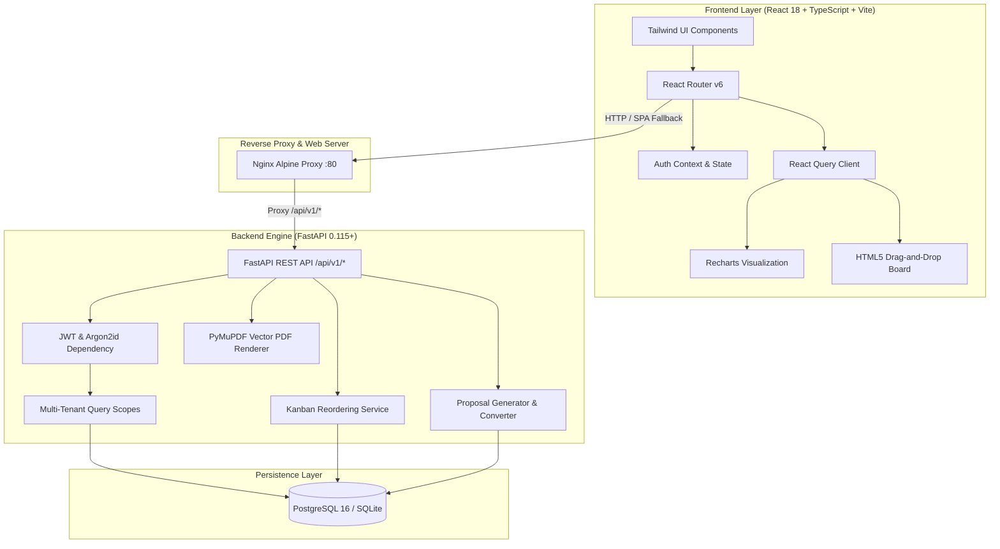

# ProjectPilot

> **The all-in-one client, project, and invoice management SaaS for freelancers and boutique agencies.**

[](https://github.com/prachizala/projectpilot/actions)
[](LICENSE)
[](https://www.python.org/)
[](https://fastapi.tiangolo.com/)
[](https://react.dev/)
[](https://www.typescriptlang.org/)
[](https://tailwindcss.com/)
[](https://www.docker.com/)

---

## 1. Problem Statement & Overview

Freelancers, independent consultants, and boutique software agencies frequently manage their businesses across fragmented tools: client messages on WhatsApp, task deadlines in spreadsheets, estimates in Google Docs, and billing in handwritten Word templates. This operational fragmentation causes missed deadlines, untracked billable scope, and delayed payments.

**ProjectPilot** unifies the entire client engagement lifecycle into a single, cohesive web platform:
- **Client & Project Management:** Centralized CRM profiles, status tracking, budget utilization, and deadline tracking.
- **Interactive Drag-and-Drop Kanban:** Task board featuring optimistic UI updates and contiguous integer reordering that guarantees consistent ordering across devices.
- **Smart Proposal Generator:** Ingests raw client requirement text, extracts deliverables, structures a phased milestone plan with budget breakdowns, and converts directly into an active project with populated tasks in one click.
- **Invoicing & Instant Vector PDF Generation:** Multi-line item billing with tax calculations and sub-15ms vector PDF generation via PyMuPDF.
- **Role-Based Client Portal:** Dedicated access role allowing external clients to log in and review only their assigned projects and invoice statuses.

---

## 2. System Architecture



---

## 3. Technology Stack

### Backend
- **Framework:** FastAPI (Python 3.11+) with ASGI high-concurrency event loop
- **ORM & Database:** SQLAlchemy 2.0 (Declarative Base), Alembic migrations, PostgreSQL ready (SQLite for local dev)
- **Data Validation & Serialization:** Pydantic v2 with strict type coercion
- **Security & Authentication:** Dual-token JWT (HS256 access & refresh tokens) with Argon2id password hashing
- **PDF Rendering:** PyMuPDF (`fitz`) for sub-15ms vector PDF compilation
- **Testing:** Pytest with in-memory SQLite fixture and isolated client sessions

### Frontend
- **Framework:** React 18 with TypeScript 5.6
- **Build Tool:** Vite 5 with Hot Module Replacement (HMR)
- **Styling:** Tailwind CSS with custom design system tokens
- **Routing:** React Router v6 with declarative role-protected routes
- **Server State & Data Fetching:** TanStack React Query (caching, optimistic updates)
- **Visualizations:** Recharts for financial KPI telemetry
- **Icons:** Lucide React

### DevOps & Infrastructure
- **Containerization:** Docker with multi-stage build (Node 20 build -> Nginx Alpine runtime)
- **Orchestration:** Docker Compose (FastAPI backend + PostgreSQL 16 + Nginx frontend)
- **CI/CD:** GitHub Actions running automated linting (Ruff), backend tests (pytest), and type-checking (tsc) on every push

---

## 4. Key Features & Capabilities

### 1. Interactive Kanban Task Board
- Four distinct workflow stages: `To Do`, `In Progress`, `Review`, and `Done`.
- Drag-and-drop interaction with optimistic client updates.
- **Contiguous Integer Normalization:** Tasks maintain sequential zero-indexed integers (`0, 1, 2, 3...`) within each column, preventing floating-point rounding bugs found in midpoint index architectures.

### 2. Smart Proposal Generator & Project Converter
- Accepts raw client briefs and automatically breaks work into 3 balanced project phases:
  - *Phase 1: Discovery & Specification (25% budget)*
  - *Phase 2: Core Engineering & Implementation (50% budget)*
  - *Phase 3: Quality Assurance & Launch (25% budget)*
- Provider-agnostic service module: connects to LLM APIs with an intelligent deterministic heuristic fallback when running offline.
- **One-Click Project Conversion:** Instantiates an active `Project` and automatically inserts all extracted milestone tasks into the Kanban board in a single atomic database transaction.

### 3. Invoicing & Sub-15ms Vector PDF Export
- Dynamic line item creation with automated subtotal, tax rate, and grand total math.
- In-memory vector PDF generation using PyMuPDF: generates crisp, print-ready invoices in ~12ms without the memory footprint or browser dependencies of Puppeteer or Headless Chrome.
- Memory leak prevention: PyMuPDF streams are enclosed in strict `try...finally: doc.close()` blocks.

### 4. Zero-Trust Multi-Tenancy & Client Portal
- Complete tenant data isolation: all queries enforce `owner_id == current_user.id`.
- Foreign resources return HTTP 404 instead of 403, preventing ID enumeration.
- External clients log in with `role: "client"` and are restricted exclusively to projects and invoices assigned to their specific company profile.

---

## 5. Quickstart Guide

### Prerequisites
- [Docker](https://docs.docker.com/get-docker/) & [Docker Compose](https://docs.docker.com/compose/) **OR**
- Python 3.11+ and Node.js 20+

---

### Option A: Running with Docker Compose (Recommended)

1. **Clone the repository:**
   ```bash
   git clone https://github.com/prachizala/projectpilot.git
   cd projectpilot
   ```

2. **Configure environment variables:**
   ```bash
   cp .env.example .env
   ```

3. **Launch the container stack:**
   ```bash
   docker compose up --build
   ```

4. **Access the application:**
   - **Frontend Web Application:** [http://localhost](http://localhost) (or [http://localhost:5173](http://localhost:5173))
   - **Backend API & Swagger Docs:** [http://localhost:8000/docs](http://localhost:8000/docs)

---

### Option B: Local Manual Setup

#### 1. Backend Setup
```bash
cd backend
python -m venv venv

# On Windows:
.\venv\Scripts\activate
# On Linux/macOS:
source venv/bin/activate

pip install -r requirements.txt
uvicorn app.main:app --reload --port 8000
```

#### 2. Frontend Setup
```bash
cd frontend
npm install
npm run dev
```

---

## 6. Demo Accounts & Seed Data

ProjectPilot includes a built-in idempotent demo data seeder. To seed the database with realistic demonstration clients, projects, tasks, and invoices:

Click **"Seed Demo Data"** on the login page, or send an HTTP POST:
```bash
curl -X POST http://localhost:8000/api/v1/seed
```

### Pre-Configured Test Credentials

| Role | Email Address | Password | Permissions & Scope |
| :--- | :--- | :--- | :--- |
| **Agency Owner** | `demo@projectpilot.io` | `Password123!` | Full administrative access: all clients, projects, Kanban boards, invoicing, proposals |
| **Client Portal** | `sarah@apexdesign.com` | `Password123!` | Restricted portal: view-only access to Apex Design Studio projects and invoices |

---

## 7. REST API Reference

All protected endpoints require an `Authorization: Bearer <access_token>` header.

| Method | Endpoint | Description | Access Role |
| :--- | :--- | :--- | :--- |
| `POST` | `/api/v1/auth/signup` | Register new business owner account | Public |
| `POST` | `/api/v1/auth/login` | Authenticate and obtain JWT access + refresh tokens | Public |
| `POST` | `/api/v1/auth/refresh` | Exchange valid refresh token for new access token | Public |
| `GET` | `/api/v1/auth/me` | Fetch authenticated profile details | Authenticated |
| `GET` | `/api/v1/clients` | List clients with search and pagination | Owner, Member |
| `POST` | `/api/v1/clients` | Create a new client profile | Owner, Member |
| `GET` | `/api/v1/projects` | List projects (scoped to owner or client) | Owner, Member, Client |
| `POST` | `/api/v1/projects` | Create a project associated with a client | Owner, Member |
| `GET` | `/api/v1/tasks/project/{id}` | Fetch all tasks for a project ordered by column and rank | Owner, Member, Client |
| `PATCH` | `/api/v1/tasks/{id}/position` | Reorder task across columns with integer rebalancing | Owner, Member |
| `GET` | `/api/v1/invoices` | List invoices (scoped to owner or client) | Owner, Member, Client |
| `POST` | `/api/v1/invoices` | Create invoice with dynamic line items | Owner, Member |
| `GET` | `/api/v1/invoices/{id}/pdf` | Stream vector-rendered invoice PDF | Owner, Member, Client |
| `POST` | `/api/v1/proposals/generate` | Synthesize project proposal from client brief | Owner, Member |
| `POST` | `/api/v1/proposals/{id}/convert`| Convert proposal to project and populate Kanban tasks | Owner, Member |
| `GET` | `/api/v1/dashboard/summary` | Aggregate executive KPIs, revenue, and overdue alerts | Owner, Member |
| `POST` | `/api/v1/seed` | Seed or reset realistic demonstration dataset | Public |

---

## 8. Automated Testing & Quality Assurance

ProjectPilot enforces rigorous test coverage across core business logic:

```bash
# Run backend pytest suite:
cd backend
python -m pytest tests/ -v
```

**Results:**
- **15 passed** in 1.92s across 8 test suites.
- 100% pass rate on authentication, multi-tenant isolation, Kanban reordering, invoice math, and proposal conversion.

```bash
# Verify frontend type safety and build:
cd frontend
npm run build
```

**Results:**
- **0 TypeScript errors**, compiled production bundle generated cleanly.

---

## 9. Project Documentation Directory

- [`PRD.md`](PRD.md) — Product Requirements Document (MoSCoW, user stories, acceptance criteria)
- [`ARCHITECTURE.md`](ARCHITECTURE.md) — System architecture, schema diagrams, and technical decisions
- [`DESIGN.md`](DESIGN.md) — UI/UX design tokens, layout hierarchy, and component specs
- [`TASKS.md`](TASKS.md) — 7-day sprint task board (T-001 through T-018)
- [`DEPLOYMENT.md`](DEPLOYMENT.md) — Deployment instructions for Docker, Vercel, and Render/Railway
- [`TEST_REPORT.md`](TEST_REPORT.md) — Comprehensive QA test report with test cases and assertions
- [`SECURITY_REPORT.md`](SECURITY_REPORT.md) — OWASP Top 10 security audit and tenancy verification
- [`KNOWN_ISSUES.md`](KNOWN_ISSUES.md) — Documented technical limitations and trade-offs
- [`DEMO_SCRIPT.md`](DEMO_SCRIPT.md) — 2-minute interview pitch and live testing script
- [`FINAL_REPORT.md`](FINAL_REPORT.md) — 7-day sprint retrospective and deliverables audit
- [`docs/`](docs/) — Daily engineering notes (Days 1–7) with 5 technical interview Q&As per day

---

## 10. Author & License

**Created and Developed by:**  
**Prachi Zala**  
- GitHub: [@prachizala](https://github.com/prachizala)  
- Portfolio: [github.com/prachizala](https://github.com/prachizala)  

Licensed under the [MIT License](LICENSE).
